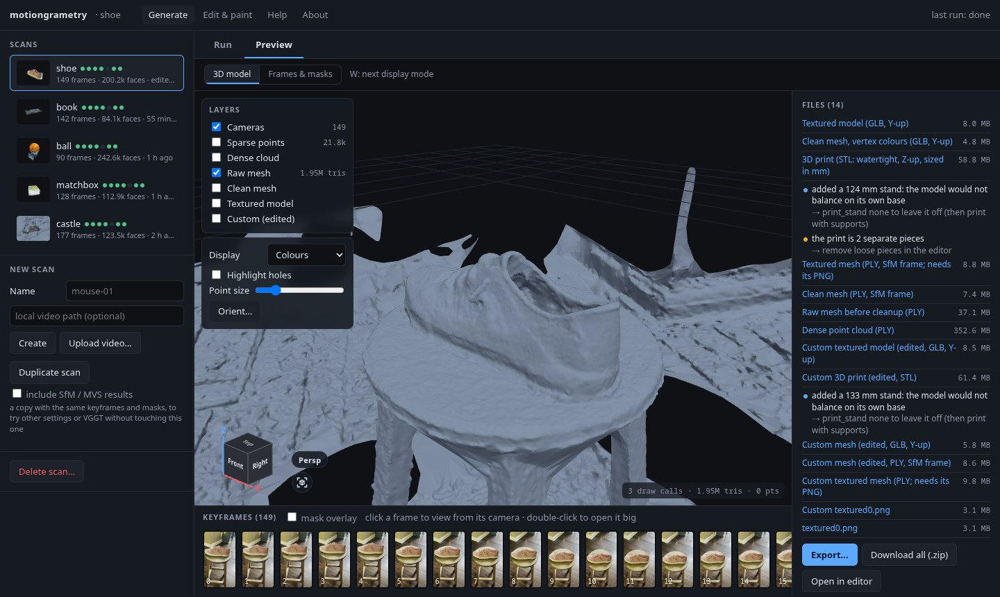
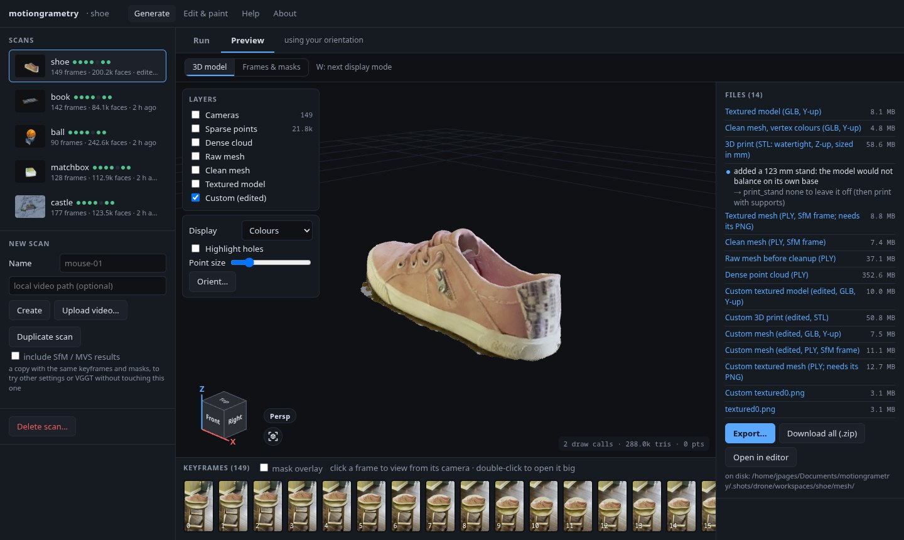
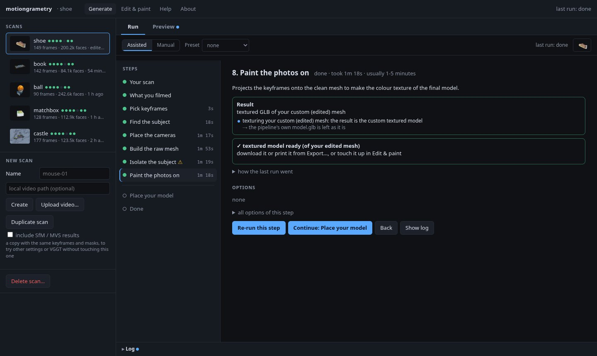
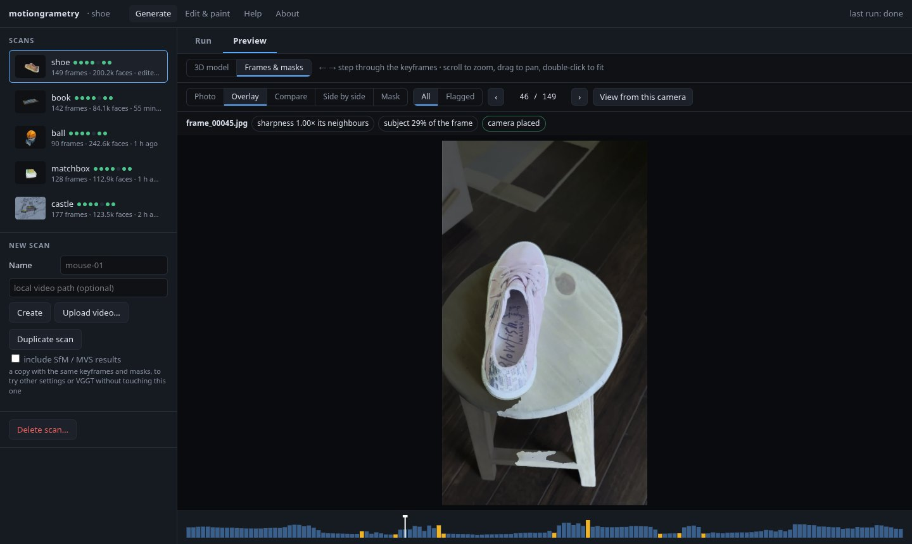
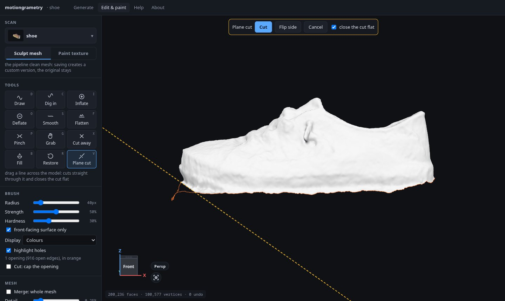
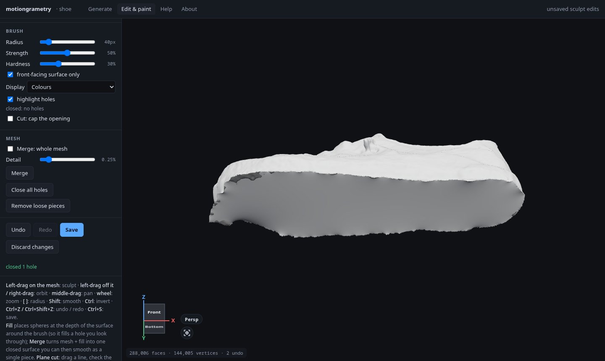
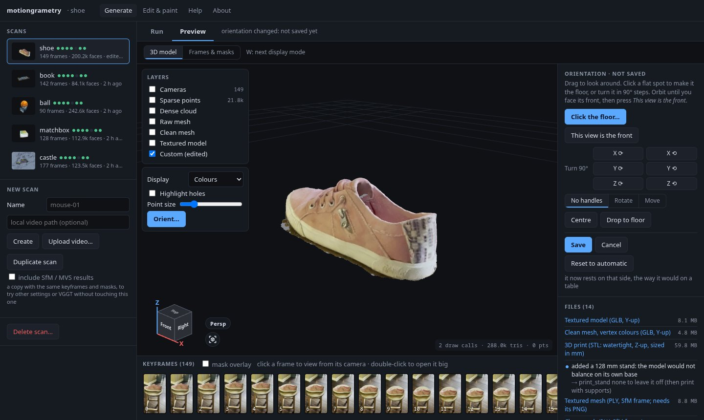
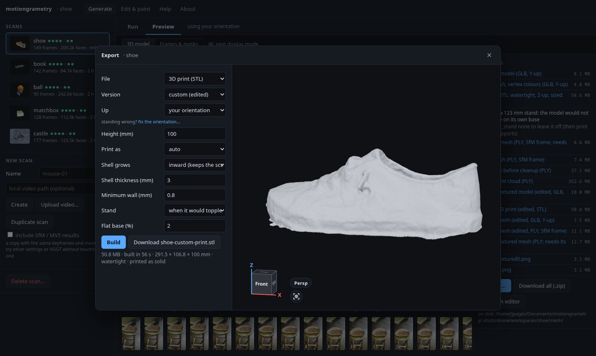

# motiongrammetry

Turn a phone video of an object, walking around it, into a clean, textured 3D model and a
print-ready file, on your own computer.

<table>
  <tr>
    <td width="50%"><br>
      <sub>What the camera saw: the shoe, the stool and the room…</sub></td>
    <td width="50%"><br>
      <sub>…and the model you get: just the shoe, cleaned and textured.</sub></td>
  </tr>
</table>

## What it is

motiongrammetry is a photogrammetry pipeline with a web interface. You film a short video walking
around something, and it finds the cameras, reconstructs the surface, cuts the subject out of the
room it was filmed in, textures it with the photos and writes files for 3D viewers and 3D printers.
A guided mode explains every step and checks each result, so you don't need to know photogrammetry
to get a good model; every option is still there when you do.

Everything runs locally: your videos never leave the machine.

## What it uses

| Part | Built on |
|---|---|
| Camera positions | [COLMAP 4](https://colmap.github.io) and GLOMAP through pycolmap |
| Dense surface and texture | [OpenMVS 2.3](https://github.com/cdcseacave/openMVS) |
| Subject masks | BiRefNet, IS-Net and U²-Net through [rembg](https://github.com/danielgatis/rembg) and ONNX Runtime |
| Mesh processing | Open3D, trimesh, scikit-image, SciPy, NumPy |
| Optional fast path | [VGGT](https://github.com/facebookresearch/vggt) (PyTorch; non-commercial weights) |
| Web interface | Python's standard HTTP server, [three.js](https://threejs.org) and three-mesh-bvh |
| Packaging | Docker, with CUDA builds for NVIDIA GPUs |

The About page in the app lists every component with its license.

## How it is built

The pipeline is a chain of stages. Each one reads the previous one's result from a scan folder and
writes its own, so any stage can be re-run with other options without starting over:

```
video ─► keyframes ─► masks ─► camera positions ─► raw mesh ─► clean mesh ─► texture ─► exports
         sharpest,    AI       COLMAP / GLOMAP     OpenMVS      carved with    OpenMVS    GLB, STL,
         by motion    model    (or VGGT)           (or VGGT)    the masks                 OBJ, PLY
```

- **`src/motiongrammetry/`** is a Python package with a command line, `mg`, for every stage. Each
  stage is wrapped with checks before it runs (inputs, disk, memory) and after (blurry frames,
  cameras that didn't connect, masks that missed the subject), with a hint for each problem.
- **`mg ui`** serves the web interface. It runs the stages as subprocesses, and adds the assistant,
  the 3D preview, the mesh editor and the export window.
- **`docker/`** builds one image with everything in it. On an NVIDIA GPU, the masks, the camera
  matching and the depth maps run on the GPU (the
  [benchmark](benchmarks/2026-10-31-shoe-gpu-vs-cpu/) shows 6 minutes against 16 on the CPU).

More in [docs/pipeline.md](docs/pipeline.md) (each stage, the command line, the lessons behind the
defaults) and [docs/web-ui.md](docs/web-ui.md) (the interface, feature by feature).

## What you can do with it

- **Scan an object** from a 20–60 second video: shoes, toys, figures, sculptures, a person
  holding still, and with the drone preset, buildings and bridges.
- **Follow a guided run** that picks the options for what you filmed, says why, and suggests fixes
  after each step.
- **Check the inputs**: every keyframe with its mask, with the doubtful ones flagged.
- **Edit the mesh**: sculpt, cut, fill holes, close openings, bring back what the cleanup removed,
  and paint the texture.
- **Set which way is up**: click the part it stands on, and it settles as it would on a table.
- **Export** a textured GLB or OBJ, or a watertight STL at the size you want, ready for a slicer.
- **Compare settings** by duplicating a scan and running it again, on the GPU or the CPU.

<table>
  <tr>
    <td width="50%"><br>
      <sub>The assisted run: each step explained, its result checked.</sub></td>
    <td width="50%"><br>
      <sub>Every keyframe and its mask.</sub></td>
  </tr>
  <tr>
    <td><br>
      <sub>The editor: a plane cut takes off a scrap under the toe…</sub></td>
    <td><br>
      <sub>…and Close all holes gives the open bottom a sole that follows its edge.</sub></td>
  </tr>
  <tr>
    <td><br>
      <sub>Setting which way is up.</sub></td>
    <td><br>
      <sub>Exporting a watertight print file.</sub></td>
  </tr>
</table>

## Setup

You need [Docker](https://docs.docker.com/engine/install/) (on Windows: Docker Desktop with WSL2,
and these commands inside WSL). For the GPU, an NVIDIA card with driver 580 or newer and the
[NVIDIA Container Toolkit](https://docs.nvidia.com/datacenter/cloud-native/container-toolkit/latest/install-guide.html);
without them everything runs on the CPU, more slowly.

```bash
git clone <this repository> motiongrammetry && cd motiongrammetry
./install.sh
```

The script checks Docker and the GPU and says what to install when something is missing, asks
whether you want the optional VGGT step (it shows its license first), builds the image (30–60
minutes the first time), starts the app and opens http://127.0.0.1:8765. Your scans and the
downloaded AI models go to `~/motiongrammetry`. The settings are remembered, so later you only need:

```bash
./install.sh update                   # after `git pull`: rebuild and restart, same settings
./install.sh stop | logs | status
./install.sh --port 9000              # another port (remembered, like every option)
```

All options (another scans folder or port, CPU only, adding VGGT later) and the install without
Docker for development are in [docs/install.md](docs/install.md).

## Usage

Open http://127.0.0.1:8765, create a **New scan**, and upload your video. Then, in the **Run** tab:

- **Assisted** asks what you filmed and how, sets the options, and runs one step at a time. After
  each step it reads the result and suggests fixes with one click. Its last step checks that the
  model stands the right way. This is the place to start.
- **Manual** is the same screen with every option and stage at hand, for when you know what you
  want.

When it's done, the **Preview** tab shows the model, the keyframes and masks and the files, and
**Export…** builds the file you need. **Edit & paint** opens the editor.

**Help** in the app is the full how-to: how to film, every screen and option, a worked example from
video to print with screenshots, and what to do when something goes wrong.

The same pipeline runs from the command line:

```bash
mg run capture.mp4 work/              # the whole pipeline
mg check work/ --video capture.mp4    # what would fail, and why, without running anything
mg logs work/ --list                  # what ran, how long it took, the warnings
```

## License

motiongrammetry is licensed under the [Apache License 2.0](LICENSE) (Copyright 2026 Joan Pagès; see
[NOTICE](NOTICE)). It builds on third-party software and models under their own licenses, among them
OpenMVS (AGPL-3.0, run as separate programs, its source shipped in the Docker image) and the optional
VGGT, whose weights are non-commercial. The About page lists every component with its license text;
`mg notices` writes them all to one file.

The shoe in the screenshots and the objects in `benchmarks/` are from Meta's
[uCO3D](https://uco3d.github.io) dataset (CC BY 4.0), reconstructed and edited here.
